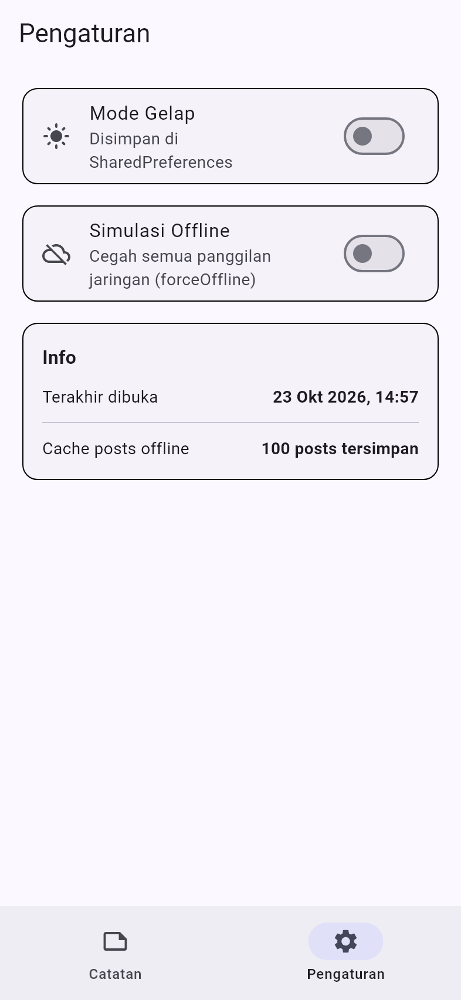
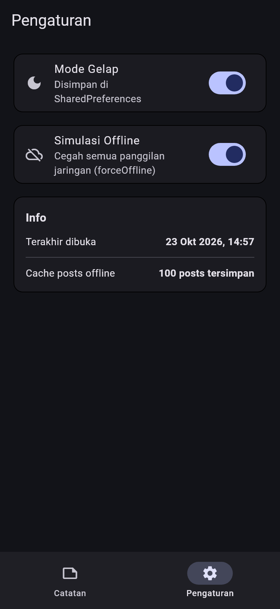
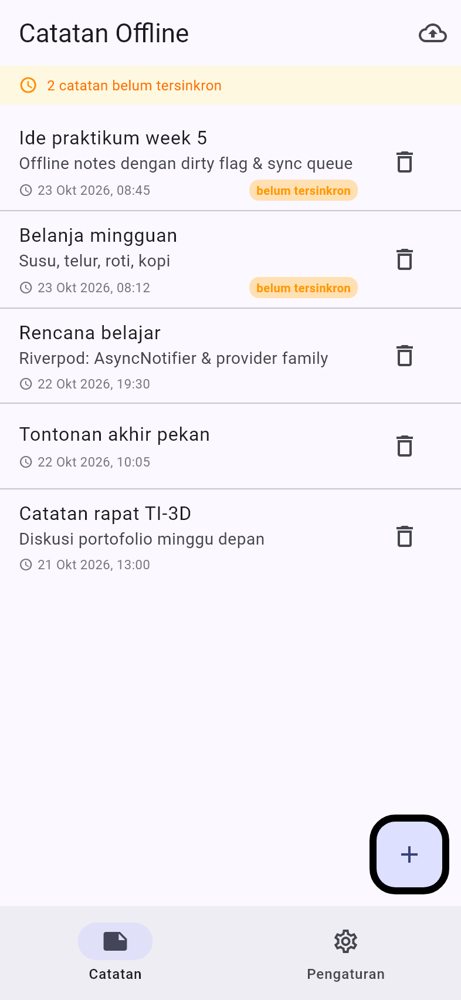
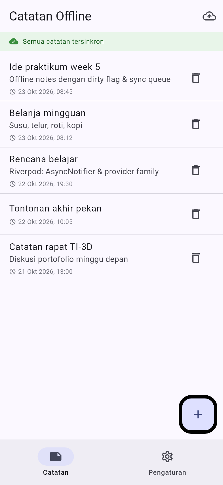
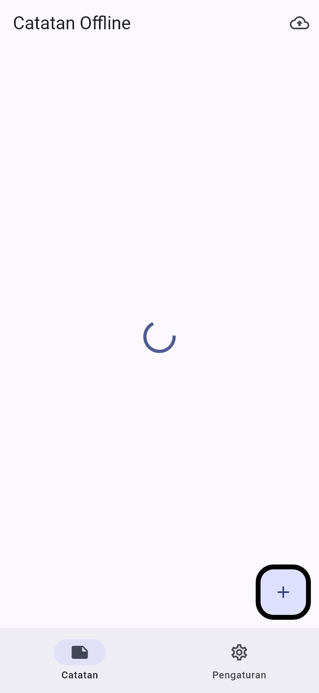
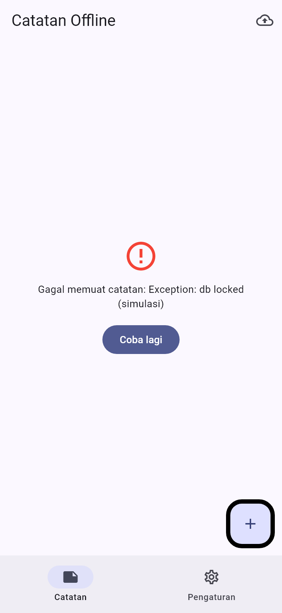
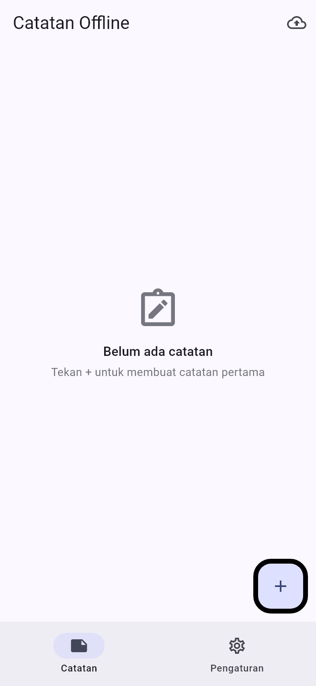
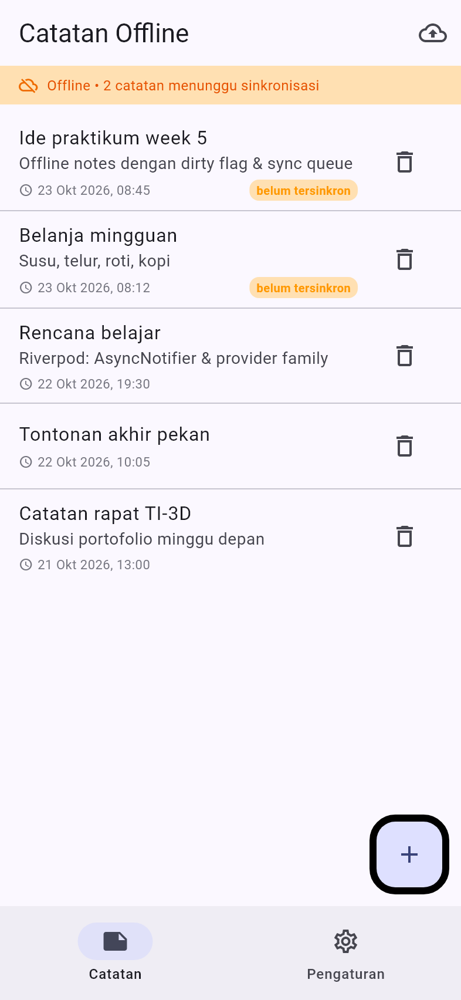
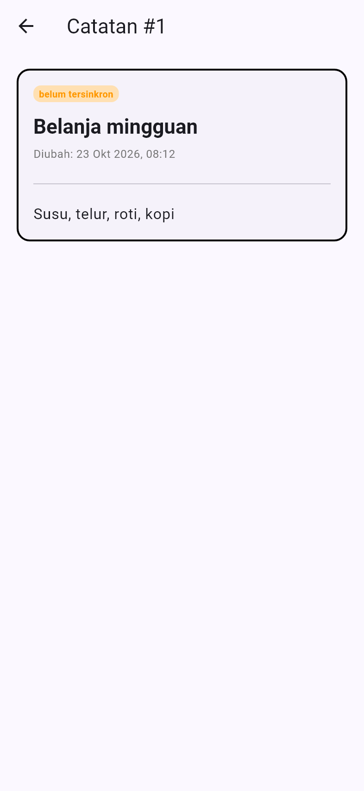
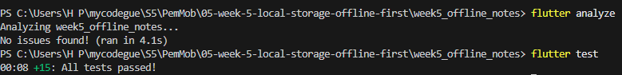

# WEEK 5: Local Storage & Offline-First

---

## Praktikum

---

## AI Challenge

- Apakah AI menempatkan daftar catatan di SharedPreferences? (menolak: rapuh untuk koleksi)

  Tidak. SharedPreferences hanya dipakai untuk preferensi key-value kecil. Daftar catatan masuk SQLite karena koleksi dengan query & update parsial rapuh bila jadi satu string JSON.

- Apakah skema AI mendukung antrean sync (dirty flag / updated_at) atau hanya CRUD polos?

  Mendukung. Skema `notes` punya kolom `dirty INTEGER NOT NULL DEFAULT 0` dan `updated_at TEXT NOT NULL` yang dipakai `countDirty()`, `markAllSynced()`, dan aturan last-write-wins.

- Apakah klaim "real-time" AI didukung stream (Drift/watch) atau hanya asumsi?

  AI mengklaim reaktivitas Drift unggul (query.watch()). Kebutuhan aplikasi ini tidak butuh reaktivitas, `invalidate` Riverpod sudah cukup, jadi klaimnya dicatat tapi bukan penentu.

- Apakah estimasi boilerplate AI masuk akal setelah Anda mencoba instalasinya?

  Masuk akal. Drift butuh code generation build_runner + file ter-generate; sqflite SQL langsung tanpa code generation, lebih sederhana untuk aplikasi CRUD kecil.

---

## Testing

.

---

## Refleksi

- Mengapa daftar catatan tidak boleh disimpan di SharedPreferences? Apa yang rusak jika aturan ini dilanggar?

  SharedPreferences tidak cocok untuk daftar catatan karena dirancang untuk data kecil. Jika dipaksakan, pengelolaan data menjadi sulit dan berisiko kehilangan data

- Kapan cache-first cukup, dan kapan Anda membutuhkan strategi lain (misalnya network-first untuk data harga real-time)?

  Cache-first cocok untuk data yang jarang berubah. Network-first cocok untuk data real-time, seperti harga barang

- Bagaimana dirty flag berubah menjadi antrean sync tanpa memblokir UI? Kapan antrean terpisah (tabel outbox) menjadi perlu?

  Dirty flag menandai data yang belum tersinkronisasi. Proses background mengirim data tanpa menghambat UI. Tabel outbox diperlukan untuk antrean sinkronisasi yang lebih andal.
